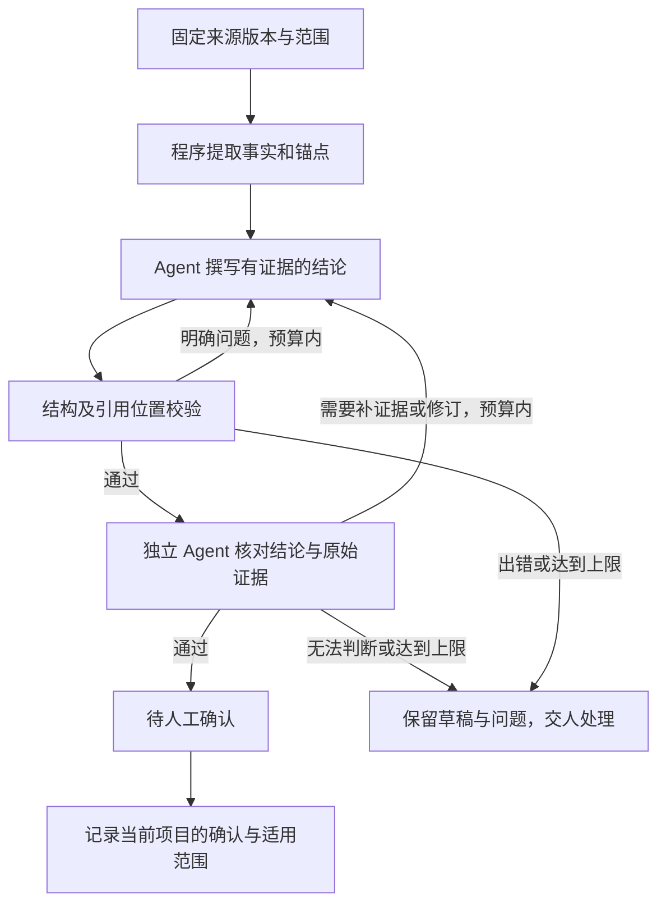

# 项目事实、可复用经验与执行策略：分类和评审闭环

日期：2026-10-22。核对代码基线：`3ecf977cec9194be80850675a112579e272206d8`。

状态：**设计完成，新增能力待实现**。用户认可分类和评审方向；这不构成任何业务知识、工单、发布或策略的人工确认。本轮仅修改文档。

承接 [项目库设计](project-knowledge-library-2026-10-20.md)、[上下文包设计](context-pack-v2-2026-10-20.md) 和 [项目库使用说明](../project-library.md)。用户提供的八张截图用于理解工单监控、经验对照评测和规则审计的产品方式；截图中的指标与自动化说明没有经过后台核验，不作为本系统的能力或性能证据。

## 1. 目标和首版边界

让团队能够回答：一条知识从哪里来、针对哪个项目版本、谁检查过、在哪些任务上验证过、当前在哪里生效，以及为什么被暂停或撤销。

统一展示三类内容，保留各自的验证方式。首版先做项目内使用和人工采用；独立评审可以自动执行，评审通过不替代人确认。组织共享继续沿用显式授权和使用方引入，不因分类或评分自动推广。

| 类型 | 例子 | 核心验证问题 | 采用条件 |
| --- | --- | --- | --- |
| 项目事实 | 某版本的审批状态、某租户的实际表结构、模块调用关系 | 固定来源是否支持这条结论？有哪些条件和例外？ | 证据核对完成；业务解释保留人工确认及适用范围 |
| 可复用经验 | 处理某类错误时先检查配置覆盖；查询前确认租户及表结构 | 使用后是否改善同类任务？是否引入回归或额外成本？ | 固定版本经验完成评测，由人确认本项目可用 |
| 执行策略 | 某类任务的检索顺序、批准范围内的上下文预算和调度参数 | 在允许调整的范围内，效果与成本是否改善？ | 参数在允许清单内，评测完成，由有权限的人采用 |

事实、经验、策略可以相互引用，但不能因为文字相同就合并来源或确认。参考项目的事实不自动成为派生客户项目的事实；参考项目的人确认也不继承到客户项目。

## 2. 已有能力与新增落点

本表描述代码已有的机制，不代表其生产使用效果已经验证。

| 现有模块 | 复用内容 | 新增内容 |
| --- | --- | --- |
| `tmh/kb.py`：`build`、`validate`、`done` | 事实块、锚点、过期检测、结构和引用位置校验；通过后仍待确认 | 按具体结论记录证据支持情况；独立评审回执 |
| `tmh/platform/survey.py`：`Survey._worker` | 知识页分批领取、Agent 撰写、运行日志 | 可恢复的撰写—评审—修订任务；有限重试 |
| `tmh/platform/project_library.py`：`bindings`、`run_current` | 固定修订、范围授权、派生关系、运行输入检查 | 评审和采用同样绑定来源及使用方版本 |
| `tmh/platform/learn.py`：`on_candidate_accept`、`impact`、`_credit` | 验收来源、候选经验、使用记录、留出对照统计、暂停复核 | 每条候选经验的成对评测和版本采用记录 |
| `tmh/platform/learn.py`：`_run_case`、`score` | 从历史提交运行方案评测、记录文件定位精确率和召回率 | 增加按任务行为定义的验证器；文件命中率不代替业务正确性 |
| `tmh/platform/memory.py`、`tmh/platform/ui_memory.py`、`tmh/platform/org_knowledge.py` | 知识目录、经验卡、问题簇、交接视图 | 类型筛选、版本详情、评审与评测明细、采用和撤销历史 |
| `tmh/context_pack.py`、`tmh/platform/agents.py` | 来源版本、上下文与遗漏回执 | 记录本次实际使用的条目修订和策略修订 |

现有知识页、经验日志和引用关系继续作为各自的权威记录，不额外建立一份可以独立改状态的副本。现有经验状态及历史生效语义保留；首版新的采用条件只作用于新工作流，不追溯编造评审，也不批量停用历史经验。

## 3. 共同记录契约

以下是待实现的逻辑契约，最终表名在实施时确定。

| 记录 | 必须包含 |
| --- | --- |
| 条目身份 | 稳定 id、类型、所属项目、原系统的记录 id；同名跨项目不冲突 |
| 内容修订 | 不可变 revision id、完整正文、内容摘要、父修订、作者、时间、适用和不适用条件 |
| 来源证据 | 项目和来源 id、完整 Git 提交或非 Git 内容清单、知识修订、文件/符号/片段位置；工单经验还含候选和验收事件 id |
| 评审记录 | 被审修订、证据清单摘要、每条结论的判断、问题及位置、Agent/模型/提示版本、运行 id、完整输出 |
| 评测批次 | 基线和候选修订、冻结的用例与验证器、模型/工具配置、预算、每轮原始结果、错误、耗时及费用计量 |
| 采用记录 | 使用方项目/工作区、确切修订、采用者、依据、时间、被替代修订；撤销也是新事件 |
| 使用回执 | 任务和运行 id、实际注入的修订集合、注入时的授权与来源版本、后续验收事件 |

正文编辑产生新修订；旧评审和旧采用只能说明旧修订，不转贴到新内容。未取得用量数据时显示“未知”，不能将估算写成实测费用。原文、日志和截图完整保留；摘要另存，界面允许分页并提供全文，不静默截断证据。

必须分别显示三个维度：**内容是否有效、机器验证结论、人的采用决定**。人工拒绝、机器不通过、运行出错、来源过期不是同一个状态。新记录的这些状态不修改工单 `MOVES`，也不改变既有知识页和经验状态的含义。

## 4. 项目事实评审循环

- 评审 Agent 使用单独运行和上下文，不复用撰写会话的内部推理。输入为明确任务、当前修订、原始证据和检查规则；使用同一模型或不同模型均需记录，不能仅因换模型就声称独立。
- 源码、知识页和历史日志是待核对的数据，其中的文字不能改变评审规则、工具权限或操作者身份。评审运行只读；修订运行限定到本次草稿，不能修改业务代码或原始证据。
- 逐条结论给出“有支持 / 有冲突 / 缺证据 / 无法判断”，并附证据位置。引用文件存在和行号有效只是机械校验，不能替代语义核对。推断、代码实际行为、业务方要求分别标记。
- 以完整来源和正文摘要绑定评审。来源、正文、授权或工作区变化时，旧评审保留为历史，采用前重新检查；来源不可读时明确报错，不能写成“未发现问题”。
- 初始默认最多一次撰写、两次修订；轮数、耗时和调用成本上限在启动时记录。相同问题且内容没有变化时提前停止，禁止用重启新批次绕过上限。
- 临时运行故障与内容不通过分别计数。取消、超时、输出无法解析或必需证据缺失都不能生成通过结论；完成的轮次和失败现场保留。
- 页面只有在绑定当前内容的校验完成后才进入对应的待确认状态。人工补充业务答复会生成下一修订任务，不把答复转换为自动签收。

固定知识快照的评审不原地修改已发布快照；需要修订时产生新修订，旧引用继续固定到原版本。工作区中未提交的代码不能伪装成某个 Git 提交；可先记录完整临时内容清单做草稿评审，提交后重新绑定并验证。

## 5. 经验有效性评测循环

流程：有来源的工单结果 → 候选经验 → 冻结基线和用例 → 成对运行 → 独立判定 → 人工采用 → 实际使用效果观察 → 必要时暂停或撤销。

1. 候选必须注明适用项目、场景和反例。针对同一来源事件幂等生成，重复建议关联已有修订；不同租户、版本或根因的相似文本不能直接合并。
2. 候选生成使用的样本与验收样本分开。同一组验收样本如果已经反馈给修订 Agent，就不能再当作未见过的最终验证；需要新的留出样本，或者明确标为探索性评测。不得将历史答案和后来的人工修复泄漏进基线任务输入。
3. 基线与候选使用相同项目快照、输入、工具权限、模型和预算，只有被评估的经验变化。执行真实动作的用例仅在隔离的合成环境或明确授权的测试环境中运行。
4. 保存两侧完整输出；随机排列匿名 A/B 输入供评审，记录可复核的随机种子。能由程序判断的行为使用实际断言；模型偏好只是辅助信号。多轮一致不等于业务已经正确或具有统计显著性。
5. 预先固定用例集合、重要错误条件、改善目标和允许的成本变化，不能看到结果后改通过标准。没有足够样本或仅有评分时显示“证据不足”。断言失败、环境出错、超时、未执行分别列出，不能将未执行算作成功。
6. 评测通过仅产生“可供采用”的结论。由人采用具体修订后，按范围参与新任务；已有任务仍保留原输入回执。延迟重试只能归因到当时冻结的使用集合。
7. 继续复用现有留出对照与暂停复核机制。撤销采用恢复指定的、仍有权限且兼容的修订；若没有可用前版则停用，并保留历史记录和撤销原因。

项目事实不能因为带来更高的回答评分就被认定为真实；经验有效也不授权扩大访问范围。组织级共享和目标项目引入分别记录，同源项目的确认不得自动替代目标项目决定。

## 6. 执行策略与不可调整边界

首版策略只允许结构化的有限参数，例如已批准区间内的上下文预算、检索顺序和调度优先级。参数清单、范围及验证器由维护者预先确定；候选不接受可执行代码、任意系统提示替换或任意文件写入。

以下内容不进入自动优化参数：人确认与关单权限、`HUMAN_ONLY`、`AGENT_ENV`、`DANGEROUS_BASH`、`ALWAYS_PROTECTED`、guard 钩子、证据与提交绑定、跨项目共享授权、状态迁移及既有测试断言。不能为了提高自动化完成率放宽这些规则。

策略评测沿用经验评测的固定输入和隔离要求，增加跨场景回归与成本比较。首版人工采用，单次采用一个明确修订；自动生效属于后续另行限定范围的扩展。业务验收和生产部署保持现有独立流程。

## 7. 事务、恢复与兼容

- 新评审/评测任务采用持久化记录、所有权令牌和带截止时间的租约；长时间模型调用不持有数据库事务。完成时用任务令牌和预期修订进行条件更新，过期工作者不能覆盖新结果。
- 每个请求和外部运行回执有幂等键；重试不生成重复经验、重复采用或双重效果归因。取消与完成的竞态必须有唯一可审查的最终状态。
- 新的修订、回执和采用意图在同一事务中登记。现有 `learn.py` 文件日志继续是经验使用与状态的权威记录；跨数据库/文件的投影使用持久化待办、幂等投影和完成回执，不能把两次写入宣称为原子事务。投影完成前显示“处理中”，读取生效状态遵循原权威记录。
- 文件产物先完整写入并校验摘要，再原子发布；数据库只引用已经发布的文件。孤立产物可以清理，不能清理仍被任务、人工决定或历史修订引用的证据。
- 采用事务重新核对正文修订、来源版本、授权范围和工作区。两个并发采用只有一个可按相同预期版本成功，另一个收到可理解的冲突；不覆盖别人的确认。
- 迁移只增加结构及可证明的映射。旧条目缺少独立评审时显示“历史记录，未登记该项评审”，不补造通过记录，不改原人工决定。重复迁移安全，故障回滚不留半套状态。

## 8. 统一页面

在现有“知识与记忆”工作区提供三类筛选，保留知识页、经验卡和引用的原入口。列表显示类型、来源项目、适用范围、当前修订、过期情况、机器验证结果和人工采用情况。

详情按以下顺序展开：完整内容 → 来源及证据 → 每轮评审/评测 → 人工决定 → 使用任务及效果 → 修订和撤销历史。所有数字可展开到记录；空样本、未知和未执行明确显示。

人工按钮只有当前操作者具备相应身份和范围时可用。Agent 可提交草稿、启动许可范围内的评审、读取结果，不能调用人工确认或关单。只读查看不启动模型、不采用建议、不写业务状态。

## 9. 实施顺序与验收

各步均为 **todo**；本设计不能作为功能已完成的证据。

| 顺序 | 可交付能力 | 必须通过的验证 |
| --- | --- | --- |
| K1 | 三类目录、不可变修订引用、分离的验证与人工决定视图 | 历史状态不变；全文可读；来源不混淆；浏览无写入；旧库重复迁移可恢复 |
| K2 | 单页独立评审及有限修订循环，再接入 Survey | 有效引用但结论错误被识别；超时/取消/解析失败不通过；源码变化使旧结论失效；重启不重复执行已完成轮次 |
| K3 | 单条经验的冻结用例、成对评测、原始证据与人工采用 | 不泄漏历史答案；未执行不算成功；样本不足不推广；并发采用、事务故障及延迟回执不误绑 |
| K4 | 策略允许清单、隔离评测、人工采用和撤销 | 禁止参数始终被拒绝；验证输入固定；撤销不覆盖新任务；跨项目与派生确认隔离 |

复用回归入口：`tests/test_memory_workspace.py`、`tests/test_candidate_memory.py`、`tests/test_org_knowledge.py`、`tests/test_knowledge_agent_api.py`、`tests/test_library_transactions.py` 和 `tests/test_context_pack.py`。K2/K3 另外增加专门的循环及评测测试，具体路径随实现确定。

实现时先跑每步相关测试，再运行全量 `python3 -m unittest discover -s tests`；不得修改既有断言含义或通过放宽超时隐藏问题。自动化测试使用合成仓库、模拟评审回执和真实本地进程验证调度行为；这些通过只证明工程机制。模型事实核对能力与真实任务改善效果需要另行取得真实模型评测证据，不能用模拟通过代替。

首版不设置后台定时任务、不接入生产数据；待单次运行与停止/恢复行为验证后再设计调度。定时执行、自动生效、组织级推广及真实标品试点均单独记录启用范围，不以本次设计认可替代授权。
