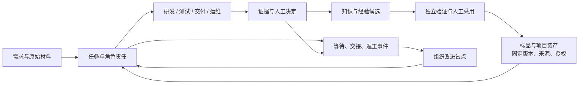

# Webuddy：软件交付与运维的组织提效

日期：2026-10-23。代码审计基线：`fe83057`，分支 `iteration/context-pack-v2`。
本轮交付：公开资料调研、代码能力审计、增量实施方案与[可交互 UI 样稿](prototype.html)。
样稿使用合成记录，未连接生产，也不代表以下新增能力已实现。

**实施更新**：O1/O2 已接入真实任务与个人交接，见[使用说明](../../task-handoffs.md)、[实际浏览器验证](implementation-evidence/browser-verification.md)和[发布记录](../../../audit/production-deployment-2026-10-23-handoffs.md)。下文保留设计时的能力基线；独立样稿仍为合成示例。

## 1. 产品方向

Webuddy 应帮助需求、研发、测试、交付和运维围绕同一项工作协作：知道目标、负责下一步的人、
可用的资产、已经验证的结果，以及还缺什么。组织价值来自减少等待、返工和重复理解，
并让一支团队验证过的成果在授权范围内被另一支团队使用。

用户提供的聊天截图提出了“组织整体提效”的目标。我们采纳这个目标，但其中“技术一定能跑”
不能替代验证：上一轮 Claude 真实执行器的启动核验仍失败，不能承诺独立模型评审已经可用。
平台流程、模型效果、生产交付和组织收益需要分别验收。

本轮范围已由用户确认：**软件交付与运维团队**。售前商务、财务、人事与泛经营管理暂不扩展。
现有客户关联、交付对象仍保留，不另建 CRM 或组织聊天工具。

## 2. 我们已有的基础与需要补的能力

下面的“已有”表示本轮代码可见；生产有效性仍受[上一轮发布验证](../../../audit/production-deployment-2026-10-22-learning.md)约束。

| 组织要完成的事 | 已有基础 | 下一步补齐 | 对应 UI |
|---|---|---|---|
| 把需求交给能接住的人 | 工单、澄清、负责人、独立复核人、个人/团队队列 | 交接目的、接收角色、交付材料、接收/退回记录 | 我的行动队列、交接详情 |
| 看清交付为什么变慢 | 首次响应、闭环、积压、退回/返工、基线报告 | 各阶段进入/移交/接收时间、阻塞原因、跨团队依赖 | 阶段队列与等待清单 |
| 基于复杂标品持续定制 | 项目角色、固定版本引用、来源授权、派生关系 | 标品版本—客户项目—服务/模块的影响范围；升级差异与复用前置条件 | 项目与资产目录、影响范围 |
| 让研发和测试共享同一事实 | 运行回执、固定候选、技术验证、人工复核 | 按交接场景整理需求/提交/环境/测试/未验证项，不重复抄写 | 证据与下一步同屏 |
| 安全交付并能接手运维 | 版本、交付产物、验收证据、项目交接说明 | 发布负责人、目标环境、回退依据、运行责任的接收回执 | 交付/运维交接包 |
| 把一次解决变为团队能力 | 知识、经验、固定来源、采用/撤销、成对评测 | 场景模板、跨项目适用性审核、使用结果回流到改进项 | 可复用资产、知识复核 |
| 持续改善组织协作 | 跨项目汇总与项目提效报告 | 选择一个瓶颈、明确改进负责人、观察窗口、质量约束与复盘 | 改进队列与指标说明 |
| 让多团队放心使用 | 个人账号、Agent/人工决定边界、知识共享授权 | 项目成员关系、服务端项目访问控制、角色权限矩阵 | 可见范围说明；不能用切换视图冒充权限 |

这不是从零补齐一个中台。最小增量是把现有任务、候选、证据和知识连接成可接力的工作对象。

### 代码证据

- [workspace.py](../../../tmh/platform/workspace.py)：工作队列提供 `updated`、负责人、复核人和待复核标记，尚不能据此推算跨阶段等待。
- [team.py](../../../tmh/platform/team.py)：`assignment`、`require_reviewer`、`item`、`dispatch_action` 已处理真实责任、候选状态、复核和请求幂等；模块明确当前是共享工作区。
- [project_library.py](../../../tmh/platform/project_library.py)：复用项目身份、来源、固定修订、引用授权和派生记录，避免另造脱离源码版本的资产库。
- [metrics.py](../../../tmh/platform/metrics.py)：`compute`、`_reopened`、`_stat` 已计算首次验收周期、14 日重开、退回、成本及封存基线比较；并非“完全没有指标”。
- [server.py](../../../tmh/platform/server.py) 的 `Platform.lead`：已有跨项目闭环、首次响应、积压和人员汇总，不能再新建一套互不相干的统计页。
- [learning.py](../../../tmh/platform/learning.py)、[learning_decisions.py](../../../tmh/platform/learning_decisions.py)：已有不可变修订、来源校验和人工决定；组织推广应扩展适用范围，不能绕过原门槛。
- [ui_workspace.py](../../../tmh/platform/ui_workspace.py)、[ui_team.py](../../../tmh/platform/ui_team.py)：当前两个入口都有个人/团队任务，工作台按粗状态推导动作，团队页的候选状态更细；需要统一动作来源。

## 3. 四个相互连接的工作循环

| 循环 | 输入到输出 | AI 可以做什么 | 必须保留的人的决定 |
|---|---|---|---|
| 任务交付 | 需求 → 澄清 → 实施 → 验证 → 交付 → 运行反馈 | 提取问题、提出方案、在授权环境执行、整理证据 | 范围、业务验收、正式采用和关单 |
| 资产复用 | 标品/参考项目 → 固定修订 → 适用性检查 → 项目引用或派生 | 检索、比较差异、提示影响模块与未验证范围 | 共享授权、目标项目适用性和本项目确认 |
| 知识改进 | 实际任务 → 候选知识 → 独立评审/成对评测 → 人工采用 → 使用反馈 | 生成候选、执行有界评审、追踪来源失效 | 采用、撤销和扩展适用范围 |
| 组织改进 | 等待/返工信号 → 瓶颈假设 → 小范围试验 → 观察结果 → 标准更新 | 聚合事实、提出可验证改进、整理复盘 | 试点选择、资源分配和组织规则变更 |

这里的 loop 是有明确输入、停止条件和责任人的工作循环。模型执行循环只负责其中获准的步骤。
跨角色等待应落为持久任务和交接记录，不让一个模型进程无限等待或自行宣布闭环。

## 4. 灵活底座：对象、版本、关系、事件

不把所有内容塞进一份“项目大总结”，也不为每个角色复制一份任务。
底座保留四类可组合的信息，各自有明确权威来源：

| 信息 | 建议边界 |
|---|---|
| 工作对象 | 项目、服务/模块、任务、候选提交、交付版本、环境、知识修订；保留稳定标识与所属范围 |
| 固定版本 | 代码 SHA、知识 revision、证据摘要、环境回执分别记录；当前工作区与历史冻结版本分别展示 |
| 类型化关系 | 来源于、依赖、派生、引用、验证、部署到、由谁负责；关系包含来源和有效范围 |
| 可追溯事件 | 谁在何时基于哪个版本移交、接收、退回、阻塞、恢复、作出决定；可回放、可对账 |

业务工作流作为这些对象的视图和规则。首版只增加现有流程的展示映射与交接事件，
不修改既有 `MOVES`，不新增一套与原工单状态冲突的万能流程引擎。
参考项目以后转为维护项目时，保留项目身份、来源关系和历史版本；重新建立执行范围与目标项目确认。
来源项目的人工通过结论不能自动成为派生项目的验收。

建议新增的交接记录至少包含：`ticket_id`、`handoff_id`、`attempt`、发送人、下一责任人/角色、
移交目的、材料清单、绑定提交与证据摘要、`requested_at`、`received_at`、退回原因、预期记录版本。
“收到材料”只表示接收事实，不表示测试通过、代码采用、业务验收或关单。

增量写入须复用已有事务与幂等约定：期望版本比较、请求唯一标识、决定/事件在同一事务内登记，
外部通知或执行在提交后处理并保留不确定结果。不得持有数据库写锁等待模型；
跨文件发布仍用既有可恢复待办，不宣称数据库和文件天然构成一个原子事务。

## 5. UI 改造

审计依据是当前源码和仓库保存的 10 月 22 日本地完整实屏，未把旧截图当作 10 月 23 日线上状态。
现有浅色与深绿品牌可以沿用，主要改动是任务组织和信息层级。

### 首页和详情

1. **工作台区分“我的下一步”和“团队流转”**。个人视图回答今天要做什么；团队视图回答哪里需要协作。
2. **阶段条可点击**。需求、研发、测试、交付、运维显示当前队列、阻塞、时间未知项；点击直接筛任务。
3. **任务队列同时显示现在与下一步**。当前负责人、下一位责任人、等待原因、所缺材料、进入阶段时间。
4. **同屏详情**。选中任务后查看原始需求、当前固定版本、机器结果、人工状态和交接包。
5. **统一真实动作来源**。复用团队候选状态，不让工作台笼统显示“继续处理”掩盖过期证据或待复核。
6. **手机仍能看见责任人**。现有团队列表小屏隐藏负责人/复核人，应改为堆叠显示，不丢失交接信息。

### 导航建议

| 入口 | 内容 | 迁移策略 |
|---|---|---|
| 工作台 | 我的下一步、团队流转、协作阻塞 | 将团队队列纳入同一上下文，保留旧 team 路由 |
| 项目与资产 | 项目、标品、参考库、版本与依赖 | 复用 projects/library，显示固定引用与执行范围 |
| 任务与交接 | 需求、任务、交接包、交付记录 | 复用原对象，避免复制状态和证据 |
| 知识与经验 | 事实、经验、策略、待确认/失效 | 复用 memory/learning 的原文和人工决定 |
| 改进 | 现有报告、瓶颈清单、试点及复盘 | 先统一指标命名与数据来源，再增加试点记录 |

角色视图只改变筛选和阅读顺序。访问权限由服务端校验，不能依靠前端隐藏入口。
管理配置、模型运行日志和高级工程工具保留在对象的二级入口。

### 样稿使用

打开 [prototype.html](prototype.html) 可切换视图/项目、筛选阶段、选择任务、查看完整证据和资产复用/交接内容。
所有数据均为明确标识的合成数据；交互只改变本地演示状态，不登录、不写生产、不触发模型或人工确认。
正式 UI 的空、加载、失败、无权限、来源过期与无样本状态都需保留。

已在 Chrome 实际检查桌面与 390px 手机布局，详情见 [验证记录](VERIFICATION.md)。
原始浏览器截图：[桌面当前视口](screenshots/desktop-current-view.jpg)、[桌面完整页面](screenshots/desktop-full.jpg)、[手机完整页面](screenshots/mobile-full.jpg)。
图像保留浏览器返回的原始字节和尺寸，没有二次压缩、裁剪或重编码。

## 6. 效率指标如何验收

我们要检验的是组织交付是否改善。一次试点选择一个主要结果，同时监测质量和工作负担，
不以模型调用数、代码行数或个人关单排行榜代表组织生产力。
这一原则与 [SPACE 的多维度测量](https://www.microsoft.com/en-us/research/publication/the-space-of-developer-productivity-theres-more-to-it-than-you-think/)
及 [DORA 的端到端工作可见性](https://dora.dev/capabilities/work-visibility-in-value-stream/)一致；并不证明 Webuddy 已产生收益。

| 指标 | 计算与数据要求 | 不能怎样解释 |
|---|---|---|
| 交接响应时间 | 同次交接 `received_at - requested_at`；未接收另列当前等待；日历/工作时间口径明确 | `updated` 距今不等于等待时间 |
| 一次交接可用率 | 首次接收时材料可直接使用的交接数 / 已评估的首次交接数；列未评估数量 | 接收材料不等于业务验收 |
| 首次验收周期 | 首次 `accept` 与起点之差，沿用现有 metrics 口径并标清样本 | 不等于最后一次闭环周期 |
| 当前闭环周期 | 最近闭环且当前仍 closed 的任务，沿用 lead 口径并明确再打开处理 | 不与首次验收周期拼成同一趋势 |
| 返工/稳定性 | 保留现有验收退回和 14 日重开观察；未满观察窗单列 | 尚无重开记录不能当永久成功 |
| 复用结果 | 明确记录固定引用、实际使用及后续验收，各自计数；再看同类任务结果 | 浏览/引用次数不等于质量提升 |
| 执行成本 | 有实际计量则展示金额/点数/调用，缺计量则未知 | 不换算为未经测量的“节省人天” |

现有 `metrics.compute` 与 `Platform.lead` 的 AI 参与率也不同：前者包含运行/对话/提示词/MCP，
后者统计已完成的非 ask 运行。正式组织首页必须拆开命名或统一契约，不能把两者混为一个百分比。
每张统计卡至少包含时间窗、样本数量、分母、覆盖率、来源和刷新时间；缺值与零值分开。
多人并行等待不能简单相加为一个任务的耗时，缺少事件的历史数据明确“未记录”，不回填猜测。

## 7. 实施顺序与验收条件

| 顺序 | 可单独交付的增量 | 完成条件 |
|---|---|---|
| O0 运行基础 | 排查真实 Claude 能力检查；另列 Windows/MCP 支持范围 | 保留失败现场，通过真实受控执行验证；不单纯放宽超时 |
| O1 组织工作台 | 统一现有动作状态、跨项目上下文、同屏证据、手机责任信息 | 同一对象在工作台/团队/详情状态一致；权限不扩大；原入口可达 |
| O2 交接与等待 | 明确下一责任人、交接包、接收/退回、阻塞事件 | 并发写入、幂等重试、未知结果、历史缺事件均有测试；不改变验收/关单权限 |
| O3 标品复用 | 项目/模块责任、固定资产引用、升级影响和使用方确认 | 引用固定版本、授权撤销即时失效、派生项目确认不继承；大项目按模块检索 |
| O4 组织改进 | 统一指标契约、选一个瓶颈、记录试点和观察结果 | 能追到原任务和证据；同类范围前后比较；展示质量/成本约束与不确定性 |

O1/O2 的协作功能可先在不依赖模型的场景验证；需要真实模型评审的路径必须完成 O0。
建议先选择一个活跃项目和一个标品派生项目，采集一段完整交付周期的基线，再选一个交接瓶颈试点。
具体改善阈值在基线与业务目标明确后由负责人确定，本设计不预设“提效 30%”等数字。

每个增量沿用当前自动发布约定：定向验证、适当全量、独立提交、GitHub 推送、受控部署与上线核验。
本轮只有设计和演示文件，线上运行代码保持原版本。

## 8. 官方参考与取舍

检索日期：2026-10-23。下表左栏概述官方资料中的机制，右栏是针对 Webuddy 的设计判断。
这些资料可以证明机制存在，不能证明我们接入它们后会获得相同成效，也不能替代本项目的安全约束。

| 参考机制与官方来源 | 对本项目的启发与边界 |
|---|---|
| [Backstage Software Catalog](https://backstage.io/docs/features/software-catalog/) 将组件元数据和归属集中登记，并支持从现有代码接入；[Software Templates](https://backstage.io/docs/features/software-templates/) 提供分步输入、核对和执行记录。 | 把标品、客户项目、服务/模块放入有责任人和版本的资产目录；保留当前库的固定 SHA 与授权。目录不自动解决跨项目权限或验收。 |
| [Port Scorecards](https://docs.port.io/governance/standards-and-compliance/concepts-and-structure/) 用规则和逐层达标的等级表达标准；[Workflows & Tools](https://docs.port.io/workflows/overview/) 连接工具执行、人工输入、权限及运行记录。 | 展示具体缺失项和整改入口，例如证据过期、测试未执行、回退依据缺失。总分不能替代强制门禁，也不能让模型自行解除门禁。 |
| JSM 的 [Deployment Tracking](https://support.atlassian.com/jira-service-management-cloud/docs/set-up-deployment-tracking/) 关联服务、部署和变更请求；[Deployment Gating](https://support.atlassian.com/jira-service-management-cloud/docs/what-is-deployment-gating/) 允许流水线在审批节点等待。 | 将需求范围、提交、测试、环境、回退点、责任人和部署回执放进交付包。审批按钮必须对应服务端真实校验；产品套餐与工具集成有前提，不能假定现有环境已连通。 |
| incident.io 的 [Post-incident Flows](https://incident.io/hubs/post-mortem/introducing-learning-flows) 将恢复后的工作分阶段、任务和责任人；[Follow-up Sync](https://incident.io/changelog/sync-follow-ups-created-during-the-post-mortem) 回连复盘文档与后续工单。 | 将恢复运行与后续整改分别展示，使补测试、改 runbook、知识候选都能追到责任人与研发任务。不能照搬自动关闭；Webuddy 的人工关单边界继续保持。 |
| [DORA 价值流管理指南](https://dora.dev/guides/value-stream-management/) 从交付目标识别等待、交接和信息流，建议围绕瓶颈做小范围改进。 | 先把一个项目的交接事实记录清楚，再验证一项改善；不先建设覆盖所有部门的万能流程引擎。 |

因此优先建设“责任目录 + 可用交接材料 + 可解释门禁 + 复盘行动”，首页优先呈现可处理的等待。
参考产品截图中的自动化率可保留为运行指标，但不能成为组织提效的唯一主指标。

## 9. 本轮尚未完成的事

尚未把新样稿接入真实 API，未实现新增交接事件/项目 ACL，未启用定时组织改进，
未证明真实模型质量或组织 ROI。当前正式系统的 Claude、Windows、可选 MCP 已知限制继续保留。
公开产品机制只是设计参考，不表示已购买、接入这些产品，亦不需要迁移现有技术栈。
