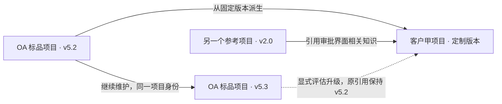

# 可复用项目资产与版本化知识库

日期：2026-10-20。核对基线：`663b98e`。状态：**设计草案，功能尚未实现**。

本设计承接用户提出的标品复用、多参考项目、大型老项目和知识库灵活性需求。它是后续实施依据，不是用户业务签收，也不宣称已经支持数十万行真实标品的完整分析。

## 1. 要支持的三种工作方式

1. **引用参考项目。** 当前项目可以参考一个或多个已有项目，只选择相关业务域、模块或文档。引用提供知识，不复制整套代码，也不授予修改来源的权限。
2. **从标品派生客户项目。** 选定标品的明确版本，建立独立开发工作区，保留派生关系。复用能证明仍适用的知识，并逐步积累客户差异。
3. **继续维护已有项目。** 一个原本仅供查阅的项目，后来可以直接进入维护流程。同一项目身份、知识和历史保留，新增开发工作区和新的代码版本。

项目不采用互斥的“参考库 / 标品 / 开发项目”三选一类型。标品可以持续开发，同时供其他项目引用；客户项目也可以成为后续项目的参考。角色用于组织和展示，执行权限单独决定。

以下是示意关系，不代表已经导入真实仓库：

“引用”和“派生”必须是两种关系：参考了某个审批方案，不代表当前项目拥有它的代码、行为或验收结果；声明从标品派生，也必须有代码基线或导入清单支持。

## 2. 现有能力与缺口

| 现有落点 | 可以复用 | 还需要改变 |
| --- | --- | --- |
| `tmh/platform/store.py` 的 projects | 稳定项目 id、代号、名称、工单和运行关联 | 目前主要是一个 root；需独立表达来源、版本、工作区及引用关系 |
| `tmh/parsecache.py` | 按文件缓存解析结果、识别内容变化 | 跨版本复用需要同时核对解析器和配置，不能只比较 mtime/路径 |
| `tmh/graph.py` | 代码事实、业务流和依赖关系、节点内容指纹 | 图谱目前整体计算和写入；多来源节点命名空间、模块级重算及大规模成本尚需实现和测量 |
| `tmh/kb.py` | 事实/业务理解分层、来源锚点、过期判断、任务领取、人工确认 | 需区分来源项目确认与当前客户适用性；增加知识修订版本和派生差异 |
| `tmh/context.py` | 词法检索、业务词扩展、图谱关联和有预算的上下文 | 目前一次缓存一个项目；需多来源检索、版本固定、完整引用与全文读取 |
| `tmh/platform/knowledge.py` | 应用层统一的知识读取接口 | 当前按单一项目 root 读取；需提供带来源的统一检索结果 |
| `tmh/platform/survey.py` | 分批撰写、队列、停止和继续 | 这是知识页写作任务的恢复基础，不能当作静态解析全阶段的断点恢复证明 |
| `tmh/platform/agents.py` 与 `agent_api.py` | 任务上下文、方案与执行、候选证据绑定 | 需将实际使用的知识版本和引用集合纳入运行输入，保留可审查记录 |

已有文档记录过约 9.4 万行合成 Java 项目的测试；本轮没有复跑。该历史记录不能证明数十万行复杂真实标品的分析质量、内存和耗时。新增能力不以换一个“标品”标签作为完成标准。

## 3. 核心模型

以下为逻辑实体；具体表和存储布局在实现时演进，不要求立即引入外部数据库。

| 实体 | 主要内容 | 必须保持的性质 |
| --- | --- | --- |
| Project | 稳定身份、名称、可组合角色、模块组织和可用工作流 | 角色变化不换项目 id；不是执行授权 |
| Source | 所属项目、代码仓库或文档来源、来源类型 | 一个项目可有多个来源；位置可以变，身份不依赖绝对路径 |
| SourceVersion | Git 完整提交或非 Git 内容清单及摘要、父版本、来源 | 固定后不可原地改写；分支名和目录名不能充当版本证据 |
| Workspace | 开发目录、关联项目/来源/基线、执行能力及所有权 | 可变工作区与固定知识来源分离；同一项目可有多个工作区 |
| KnowledgeRevision | 来源版本集合、解析器/配置版本、图谱与知识页修订、构建状态 | 相同代码可以有新的解释和人工纠正；旧修订和旧引用仍可读取 |
| ReferenceBinding | 使用方、来源知识修订、用途、模块范围、更新策略 | 支持多个来源；默认固定版本；不隐式递归扩展整个引用网络 |
| Derivation | 派生项目、源版本、实际代码基线、模块映射和证据 | 区别可证的 Git 派生、导入复制和仅人工声明；未验证关系不升级为事实 |
| KnowledgeItem / Evidence | 类型、正文、来源位置、内容摘要、适用范围、确认与修订历史 | 稳定且可限定到来源的 id；同名类、表、页面不得跨项目合并 |

代码事实的定位至少包含 `source_id + source_version + path + symbol`，引用再绑定知识修订。行号是阅读位置，不承担唯一身份；重载、同名包或多仓库的同名符号必须保留区别，无法唯一定位时显示不确定。

知识来源需要可扩展：首版代码和随仓库文档共用来源模型；后续接口文档、数据库结构说明、用户手册、历史设计和业务决定可以成为不同类型的证据。项目关系、版本、权限和引用契约保持稳定，解析器与存储后端可以替换。

## 4. 知识的继承、差异与确认

把内容分成三层，检索时保留层次和来源：

- **来源事实：** 标品固定版本中的代码、接口、表、调用关系及相应证据。
- **业务解释：** 对这些事实的说明、推断和人工纠正，单独版本化并注明适用条件。
- **当前项目差异：** 客户自己的需求、配置、接口、数据约束、代码改动和例外规则。

复用的是有来源的知识引用，不是把所有说明复制进客户项目。相同文件内容可以复用解析缓存，但必须匹配解析器、配置与依赖条件。业务知识的有效性还依赖调用者、表结构、配置和模块关系，不能因为某个文件没改就直接判为适用。

客户项目修改代码后，只让受到依赖变化影响的知识进入待复核，并保留旧内容与失效原因。共享标品知识不被客户差异回写。把客户经验反馈给标品属于一次独立建议和审核，不能自动发布共享。

来源项目中的“已确认”只表示某人确认过该来源版本的说明。客户项目应显示“来源已确认，当前项目适用性待核对”；不得继承成人工验收、当前业务正确性或自动关单的依据。代码事实、模型推断、参考资料和用户决定始终分开。

参考资料之间有矛盾时并列展示：例如标品规则是两级审批、参考界面是三级审批，而客户要求尚未明确。不能按搜索分数选一个当成需求，更不能覆盖客户已经确认的合同。

## 5. 版本与生命周期

### 固定发布和构建恢复

知识构建先固定来源版本及分析配置，再在独立构建位置生成结果。构建清单记录成功、失败、未支持和未分析的部分，完整性通过后发布新知识修订；取消、崩溃或部分失败不能替换原可用修订。

同一项目并发构建要隔离临时文件，防止旧构建迟到覆盖新版本。任务恢复依赖持久检查点、实际产物和锁所有权，不依赖历史 PID 或文件存在。引用方读取已发布修订，不读取写到一半的图谱和知识页组合。

未提交工作区可以提供标明“临时”的任务上下文，不能冒充可长期引用的发布版本。非 Git 来源需要可复验的完整内容清单；不能把“今天扫描过这个目录”当成固定版本。

### 标品更新

标品 v5.3 发布后，使用 v5.2 的项目只收到“有新版本可评估”的提示。升级流程比较代码、配置、知识依赖和客户改动，形成影响与冲突清单，再由明确操作更新绑定。旧任务继续保存当时使用的 v5.2 证据。

### 参考项目进入开发

保留项目、来源和知识历史，选择明确的基线，创建或关联可写开发工作区。之后产生新的 SourceVersion 和 KnowledgeRevision；原有引用方仍指向旧版本。启用开发工作流不自动启动模型、迁移数据、合并或部署。

### 从标品派生

创建新的客户项目身份和独立工作区，记录源版本、实际复制/派生的模块以及使用的知识修订。不要把“直接维护标品本身”与“给某客户建立定制项目”合成同一个按钮，也不要默认覆盖标品仓库。

## 6. 大型项目的分析与检索

1. **先建立清单和结构。** 识别仓库、模块、入口、表和依赖，显示支持范围、排除项、失败和待分析数量。生成目录不等于理解业务完成。
2. **按层分析。** 文件/符号事实 → 业务流 → 模块/业务域 → 全局概览。对每层保存证据和依赖；高层主要读取已形成的下层结果，需要时再展开源码。
3. **按需深化。** 当前任务涉及的模块优先补全。未写说明的模块仍可查代码事实；明确显示待分析状态，不隐去未完成范围。
4. **分批且可恢复。** 解析、关系计算、知识撰写各有检查点和预算。失败后继续未完成部分；配置或解析器变更使对应缓存失效。跨模块依赖变化仍须传播，不能只更新文件本身。
5. **先选范围再检索。** 当前项目及差异优先，在显式绑定的来源和模块中检索；组合代码词法、符号/图谱和业务知识。向量检索可作为后续后端，不是首版强制基础设施。
6. **完整原文与上下文摘要分离。** 上下文可分页或选取片段，但必须返回来源、覆盖范围、遗漏提示和读全文入口；预算不足不能默默截掉用户需求、AC 或原始证据。原文不截断、不降质。

跨项目结果要携带项目、版本、知识修订、模块、文件/符号、有效状态及引用用途。相同关键词命中不同产品的同名表时，必须分开显示。来源不可用或无权访问时明确返回不可用；必须依赖该来源的任务应阻止推进，不能用空结果假装没有影响。

首版先复用本地文件与 SQLite。把 `SourceReader`、`KnowledgeStore`、`KnowledgeSearch`、`ContextAssembler` 定义成窄接口，使以后可换存储、增加语言或语义检索，而不重写项目关系及验收规则。不承诺首版实现分布式图数据库或完整增量图计算。

## 7. 权限、隔离和证据

- 注册或引用不触发来源仓库里的构建脚本、安装钩子和应用服务。静态分析把源码/文档视为资料，不能执行其中的操作指令。
- 引用方只有读取获准知识的能力。只读通过实际目录/执行权限与服务端路径检查实现，不能只写在提示词里。可写范围仅限任务的独立工作区。
- 客户知识、附件和派生差异默认私有；项目角色不代表共享许可。跨项目引用要核对来源的分享范围，撤销后阻止新的读取；保留的历史审计也应遵守权限与保留策略。
- 原始代码与文档、缓存、检索结果均需检查来源边界。符号链接、相对路径和相同文件名不能越过授权范围；密钥和证书不进入知识库。
- 运行保存实际使用的引用版本集合、知识修订及摘要。影响本任务的引用或资料变化后，原方案/技术证据需按绑定规则重新核对；不能以未相关知识的变化无条件触发所有项目重跑。
- 所有已有人确认、保护规则、状态迁移和代码提交绑定继续生效。新增“知识已构建 / 资料可参考”状态不能替代测试通过或用户验收。

## 8. 页面和 Agent 使用方式

项目管理增加三个清楚的动作：**登记已有项目、从标品派生、创建空白项目**。登记时可选择仅供知识查阅，先显示路径、版本和支持范围，再明确启动构建。

项目详情包含：来源与版本、知识覆盖、参考项目、派生关系、开发工作区。引用页可以添加多个来源，选择固定版本、用途及模块范围，并打开每个来源的原文。构建状态显示阶段、数量、失败原因和继续入口，不用单一“完成率”掩盖未支持的代码。

在查阅项目上提供“开始维护”；在标品上提供“派生客户项目”。这两项均说明作用对象和代码基线，保留原知识，不要求重新登记同一个项目。

网页、CLI、MCP 共享同一来源/引用/检索契约。Agent 获取任务包时看到当前可写工作区、当前项目知识、固定参考来源、差异与不确定项；只有明确启用执行能力时才能启动相应任务。人工批准入口不开放给 Agent。

## 9. 分段实施与完成标准

| 阶段 | 交付内容 | 完成依据 |
| --- | --- | --- |
| A：项目与来源版本 | 兼容旧项目登记，增加来源、知识修订、固定引用、开发工作区关系 | 旧数据库迁移测试；同一项目可查阅后维护；来源与工作区分离；不自动执行 |
| B：首条完整复用路径 | 一个客户项目引用两份不同版本的资料，按模块检索并进入任务包；从固定标品派生 | API、CLI/MCP 和浏览器实际流程；每条结果可读到确切版本原文；原项目字节保持 |
| C：知识差异与更新 | 客户覆盖层、依赖失效、标品升级对照；同项目继续维护保留历史 | 相同内容可复用，依赖变化确实失效；旧任务可复验，人工确认不继承 |
| D：大型标品接入 | 分阶段恢复、构建发布一致性、范围选择及规模测量 | 合成规模测试后，接一个用户指定的真实标品，记录范围、性能和遗漏，再判断是否可用 |

第一条完整验收场景：登记标品与另一个参考项目 → 分别构建固定版本知识 → 为客户项目绑定两份来源 → 检索同名业务并分清来源 → 从标品基线派生 → 修改一个模块 → 原来源与其他客户不变、相关知识失效 → 标品发布新版后旧引用仍可复验 → 将原查阅项目开始维护，身份和知识历史保留。

必要的反例至少包括：

- 两个项目的同名符号/表不能串库；未绑定项目或无权限来源不能检索到。
- 来源 HEAD 前进、目录搬迁、分支改名不会悄悄改变固定引用。
- 代码相同但解析器/配置变更时，不错误复用旧事实；文件未变而跨模块依赖变化时，不保留错误适用结论。
- 并发构建、构建中取消/崩溃、发布失败后，读者仍读到上一份完整修订；恢复不重复发布或覆盖新结果。
- 客户改动不能写回标品或其他客户；单纯建立引用不复制代码、不运行来源脚本。
- 来源项目确认过的知识不能自动变成客户验收通过；未知、失败和未分析都不能当通过。
- 无效派生证据、缺失原始版本和循环/过深引用需明确拒绝或报告，不无限展开。
- 预算不足只影响上下文选取，全文与原始证据保持可访问，遗漏可见。

规模验证记录冷构建/无变更重建/单模块变更耗时、峰值内存、解析命中、检索延迟与结果质量、恢复后重复工作量。合成样本覆盖至少数十万行和多模块/多来源，再用真实标品验证动态调用、配置分派、SQL 和框架覆盖。数值目标根据实际机器、技术栈和基线确定，不凭代码行数承诺“一分钟理解完”。

## 10. 兼容策略与本轮交付边界

旧项目 id、root、工单、知识路径和运行接口先保持兼容；用新增关联表表达来源/版本/工作区，把旧 root 映射为默认来源与工作区。迁移先在临时旧版数据库验证，再决定真实数据接入；本轮不迁移真实平台数据。

现有单库 Knowledge 调用可由适配层继续工作。新增检索返回带来源的结构化记录，再由上下文组装器输出给 Agent；不在每个 UI/Runner 入口各写一套跨项目拼接逻辑。不直接把不同项目的 graph.db 表或 Wiki 目录合并。

本轮只完成现状核对、统一模型、实施顺序和验收清单，未修改产品功能、未导入实际标品、未运行新的规模测试。实施前仍需要真实试点仓库、允许共享的资料范围和目标环境；这些是接入参数，当前设计按本地、离线、固定版本和私有默认值展开。

相关记录：[当前知识库](../knowledge-base.md)、[平台接口说明](../platform.md)、[Agent 接入](../workbench-agent.md)、[实施待办](../self-improvement/BACKLOG.md)、[本轮进度](../self-improvement/ralph-port-progress.md)。
