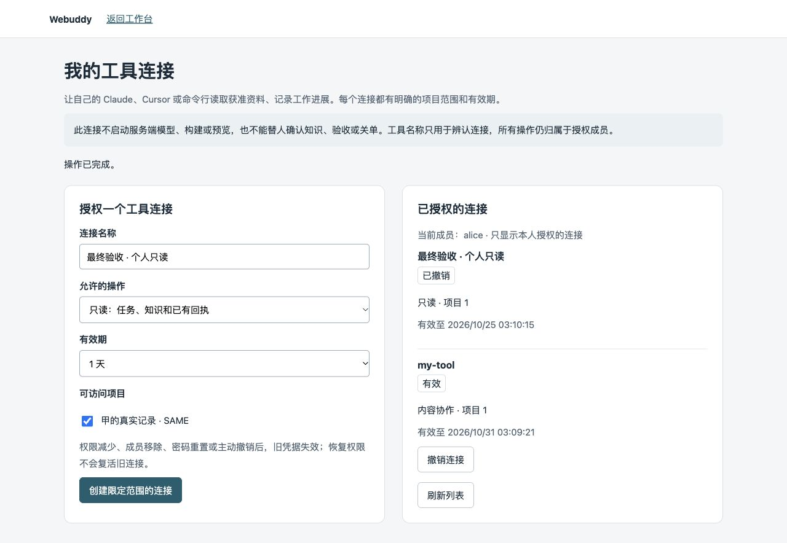
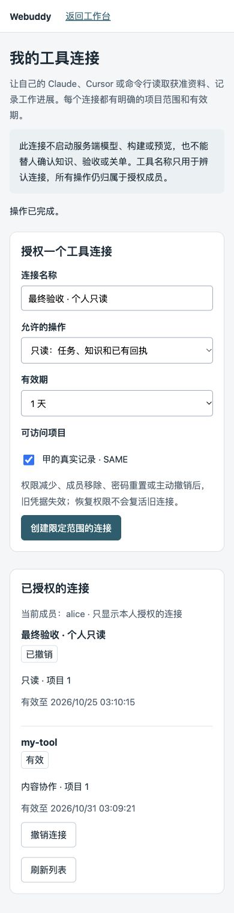

# 个人工具连接界面验证

2026-10-24，最终实现工作树，合成双租户环境、普通成员 Alice 正常密码登录。创建限定项目/期限的只读凭据，浏览器下载后通过真实 CLI 导入，回读身份与范围，网页撤销后 CLI 返回401。下载临时文件与私有导入内容核对相同后清理；不含生产会话或业务验收。

主代理亲自打开桌面1280×884和完整移动390×1542原图。移动页面scrollWidth=390；清除后凭据字符数0，控制台warning/error为空。原图字节直接复制，无裁剪、转码或降采样；SHA/长度见images.json。最终合成服务和已跟踪worker/socket/key清理见fixture-final.json。

身份复核开始时即清除页面明文，包括写请求尚未结束的窗口；身份未知不能下载，迟到响应不能复活已清凭据。30项实际JS测试和独立对抗探针通过。凭据仅显示一次，未及时保存应撤销并重建；原请求结果不明时保留并重放原编号。

这是界面、授权及协议验收，不证明真实团队提效。真实Claude两项原文照抄任务均失败（模型改动CRLF），平台保存实际参数保持完整；Cursor和Windows原生ACL未验收。

