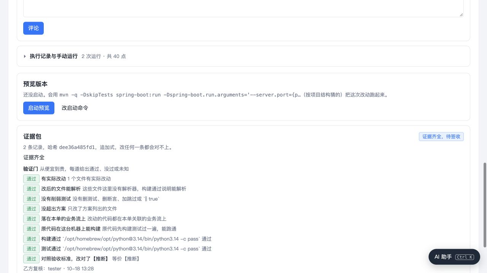
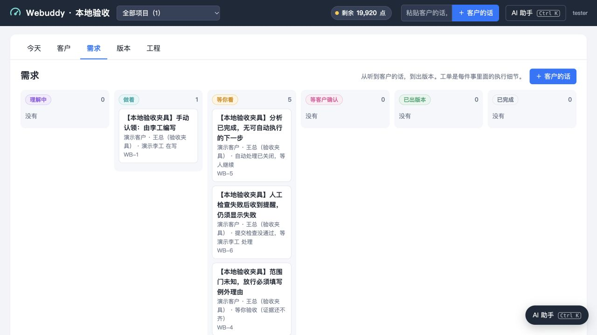

# 接续轮验证 · 2026-10-18

代码基线：`4200dd8`。分支：`codex/self-evolution-resume`。

## 完整回归

在仓库根目录执行：

```sh
env NO_PROXY=localhost,127.0.0.1,::1 no_proxy=localhost,127.0.0.1,::1 python3 -m unittest discover -s tests
```

最终结果：`Ran 232 tests in 92.583s`，`OK (skipped=2)`，退出码 0。230 项通过，2 项跳过，无失败或错误。`NO_PROXY` 仅对本条命令生效，避免本地 HTTP 测试被已有系统代理转发；未修改全局网络配置。

2 项跳过来自当前 Python 缺少可选 `cryptography`，签名的 `ssh-keygen` 路径仍在本次回归中执行。日志含原有资源清理警告（HTTPError/socket），尚未作为本轮功能修复处理。

完整原始日志：[最终回归](evidence/2026-10-18-unittest-final.txt)；[首次回归](evidence/2026-10-18-unittest.txt) 也保留。均未截断，SHA-256 由原文件和归档文件对比确认一致。前端“下一步”最后一次筛选调整另通过完整页面脚本 `node --check`、4 个实际函数行为场景（当前失败后提醒、新运行不沿用旧失败、AI 运行不沿用旧人工失败、当前检查未知）和重启后的浏览器复验。

新增行为覆盖：

- `test_intake_handoff.py`：6 个测试，包括两个真实双线程时间窗口、最新控制标志保留、关闭工单、未确认草稿、全局自动处理关闭和满足条件才续跑。
- `test_workbench_states.py`：10 个测试，核对客户、需求和详情的一致状态；包括仅分析无后续、手工检查失败后的提醒、旧运行迟到结果。

## 浏览器验收

使用 Codex 内置浏览器，服务仅绑定 `127.0.0.1:55959`。数据、代码库和执行程序都在隔离临时目录；真实模型没有参与。页面品牌“Webuddy · 本地验收”，客户和工单明确标注“验收夹具”。

- **WB-3 普通复核**：由本地伪智能体跑方案、改动、验证和采纳，生成 9 道通过的门。点击“复核”立即记录，未要求理由；页面从“还缺乙方复核人”更新为“证据齐全，待签收”，显示实际复核人 `tester`。
- **WB-4 例外复核**：故意缺少方案文件清单，真实检查器输出范围门 `unknown`。点击复核显示逐项理由框；输入两字理由“确认”被服务端拒绝，提示“放行‘没超出方案’要写明理由”。清空例外理由后仅记录普通复核，范围门仍为未知、证据仍不齐，未被顺带放行。
- **状态一致性**：重启隔离服务加载最新代码，原工单与证据哈希保持不变。需求看板、客户详情均将手动认领放在“做着”，运行失败及人工检查失败放在“等你看”。WB-6 在失败后追加提醒，详情首屏仍显示失败；“下一步”也显示本次检查失败，提供“改好推上去了，现在检查”。WB-5 在全局自动处理关闭时明确等人继续；`auto=on, plan=false` 的边界由状态测试覆盖，未为页面演示开启自动流转。

普通复核截图已实际查看；以下 PNG 保留截图原始字节，没有缩放像素、重编码或压缩：





## 独立复核与实际边界

独立审查确认快捷复核不传放行标志，服务端仍逐项检查；构建/测试失败不能写理由放行。并发改动使用可重入锁，重打包在锁外，未发现本轮新增死锁。

审查发现的“自动线没有下一步却称正在继续”“提醒覆盖人工失败结果”两处问题，均修正、补回归并通过复审。

本轮没有接入生产、推送或合并 `main`。尚未证明真实模型能够从真实客户原话完成全流程；这属于后续 SI-002，不能用本地夹具结果替代。
