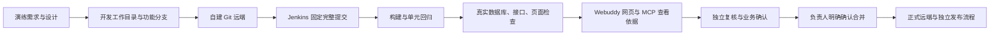

# 私有 Git、Jenkins 与 Webuddy 全流程演练

这套演练使用自建 Git 服务与真实 Jenkins，复用已定制的 JSHERP 退款说明场景。Git 服务、构建、数据库、接口、浏览器和报告都真实执行；需求、账号、角色和业务数据是演练材料，不是怀柔项目验收。Jenkins 不承担代码仓库职责。



本轮自动演练到 Git 隔离主分支的合并与推送。图中的真人决定在 Webuddy 中保持待处理；演练 Git 合并回执明确 `human_review=false`、`business_accepted=false`，不将 Agent 操作冒充 Leader 批准。生产发布没有执行。

## 当前实际部署

| 部件 | 位置与职责 |
|---|---|
| 自建 Git | Mac Docker 的 `webuddy-demo-git`，独立数据卷，SSH `127.0.0.1:12222/repos/erp.git` |
| Jenkins | Mac Docker，`https://127.0.0.1:18443/job/erp-verification/`，控制侧固定流水线，按完整SHA checkout |
| 构建与业务测试 | Linux Jenkins演示容器，Java8/Maven、Node、Chromium；Docker内网MySQL/Redis |
| 开发目录 | 单独克隆的演练目录，不修改原ERP工作区 |
| Webuddy | 独立演练数据目录和端口，网页/MCP读取同一份方案与原始外部运行记录 |
| Windows | 自有测试执行机；本轮ERP Jenkins没有派发给Windows，个人MCP凭据限制仍保留 |

仅绑定本机回环，不是客户远程接入地址。当前自建仓库是 SSH Git 服务，没有 Gitea/GitLab 的网页PR和受保护分支管理。演练分支的Git操作不能替代企业Git服务的角色授权和正式合并审计。无需为本轮更换Git或模型调用内核。

## 需求、设计和独立预期

演练业务规则：非零销售退款须填写去除首尾空白后5—200个Unicode字符的说明。新建和修改共用后端校验，页面提前给出同一规则。零退款及其他类型单据保持原规则。

| 场景 | 独立预期 | 检查方式 |
|---|---|---|
| 空白、过短、过长说明 | 明确拒绝，数据库不增加单据 | HTTP返回、错误码、MySQL计数 |
| 单账户有效退款 | 金额与说明保存正确，API和页面可回读 | 数据库、API、浏览器 |
| 多账户退款 | 分摊与总额一致，说明保留 | 数据库明细、API、页面 |
| 重复提交 | 不增加第二张单据 | 即时/延迟请求、数据库计数 |
| 未登录请求 | 拒绝写入 | 未授权HTTP与数据库检查 |
| 财务过账、库存审核 | 本轮不作通过结论 | 明确排除 |

预期来自控制侧演练规则与既有检查；不是运行后按实现结果改写。基线和候选共用相同控制侧业务脚本。旧版本允许空说明，预期应触发失败；候选修复后再执行同一检查。规则是演示假设，客户需另行确认。

需真人决定的问题沿用[演示与追问](演示与追问.md)：适用单据、历史数据、Unicode长度、权限、异常和重复提交、环境、Review责任及合并策略。每个答案记录来源和修订；没有答案不填成默认同意。

## 可重复执行的操作

使用全新的 exercise 名称；同名目录、重复触发和已移动的演练主分支会拒绝覆盖。命令前套用[操作留痕](操作留痕.md)中的capture_step，Agent使用actor-type agent。凭据读取既有private目录，禁止放在命令参数或材料中。

```sh
python3 examples/project-testing/jsherp/jenkins-demo/rehearse.py --root '<演示根目录>' --exercise '<新演练名>' prepare
python3 examples/project-testing/jsherp/jenkins-demo/rehearse.py --root '<演示根目录>' --exercise '<新演练名>' --version baseline trigger
python3 examples/project-testing/jsherp/jenkins-demo/rehearse.py --root '<演示根目录>' --exercise '<新演练名>' --version candidate trigger
python3 examples/project-testing/jsherp/jenkins-demo/rehearse.py --root '<演示根目录>' --exercise '<新演练名>' --version baseline collect
python3 examples/project-testing/jsherp/jenkins-demo/rehearse.py --root '<演示根目录>' --exercise '<新演练名>' --version candidate collect
python3 examples/project-testing/jsherp/jenkins-demo/rehearse.py --root '<演示根目录>' --exercise '<新演练名>' merge
```

collect返回queued/running时查询原队列，不重新触发。触发前写requesting回执；网络结果未知时先查Jenkins，不删回执重发。构建回执核对完整SHA，失败不合并。合并只快进演练主分支，推送后再查远端SHA；不强推。它只验证这套受控演练的Git动作，不是新的产品审批系统。

正式客户流程仍使用产品已有需求确认、技术复核、项目验收方式和合并权限。开发Agent不能调用真人确认入口。真实Leader和负责人通过网页/终端各自完成决定，并按[逐步手动操作表](操作留痕.md#现场每一步都填写)记录实际操作与耗时。

## 网页与 MCP 取证

完成两个构建的collect后，用现有证据服务的独立演练模式启动：

```sh
python3 examples/project-testing/jsherp/jenkins-demo/evidence_server.py '<演示根目录>' --exercise '<演练名>' --port 18986
```

页面 `http://127.0.0.1:18986/#/t/ERP-1` 显示待澄清方案和两条外部测试记录。账号沿用本机合成demo-owner，密码在private目录，不进入分享材料。MCP指向同端口、只读模式，读取`development_get`与`delivery_get`；不得把外部报告导入改写为当前候选已经满足平台验收门禁。

正式现场需要按真实操作系统配置个人工具连接。原生Windows个人凭据保护尚不支持，不能用本机共享令牌演练配置冒充已经接通。

## 人员现场操作表

| 人员 | 实际操作 | 留存内容 |
|---|---|---|
| 需求负责人 | 阅读规则、逐条回复问题、确认当前修订 | 原始答案、修订、确认人和时间 |
| 开发人员 | 在正确项目与基准版本修改、提交并推送功能分支 | 预检、代码差异、提示词与手改记录、远端SHA |
| 测试人员 | 查看失败与成功原件，亲自操作关键业务 | 输入、预期、实际、截图、未覆盖项与时间 |
| Leader | 独立查看实际差异和证据，写复核意见 | 有效发现、误报、遗漏、是否批准及适用版本 |
| 负责人 | 再次确认合并，核对远端 | 明确操作、合并提交、是否推送、是否部署 |
| 业务验收人 | 判断业务是否符合已确认要求 | 通过/退回及理由，不用CI绿灯代替 |

全部真人步骤未执行时保持待填写，不将脚本模拟写成人工完成。当前真实运行结果见本轮证据记录；安装完整、技术验证、人员验收和客户收益分别判断。
